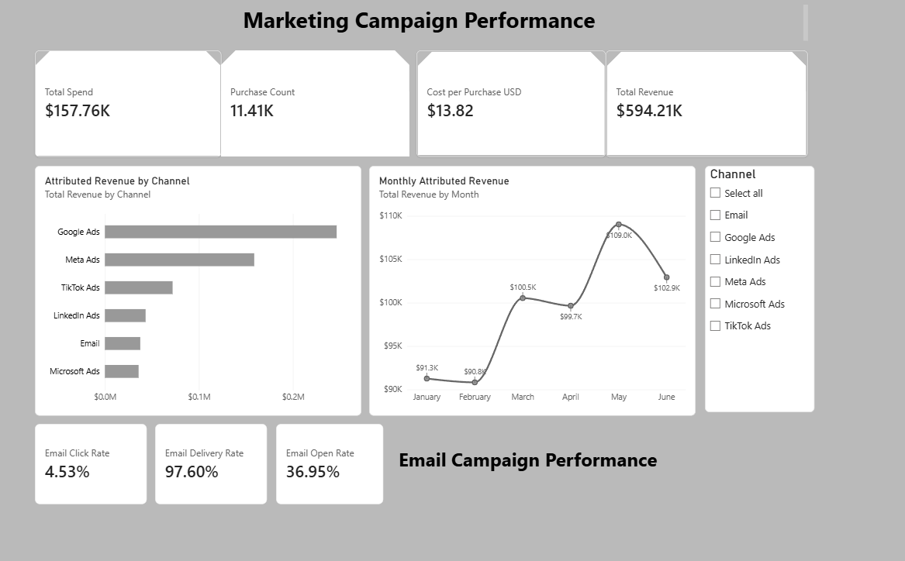
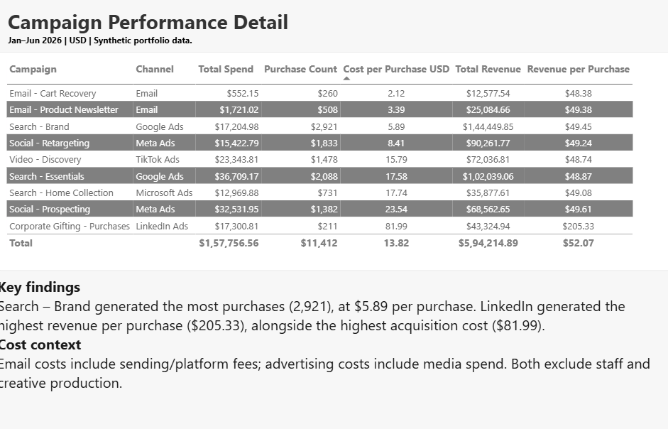

# Marketing Campaign Performance Analysis

A personal Power BI project exploring paid advertising
and email campaign performance.

## Project scope
- January–June 2026
- 9 campaigns across 6 channels
- 1,629 daily campaign records
- Entirely synthetic data; no company information

## Tools and skills
Power BI Desktop, Power Query, DAX, data visualization,
and marketing performance analysis.

## Report pages
1. Overview: spend, purchases, acquisition cost, revenue,
   channel comparisons, monthly trends, and email metrics.
2. Campaign Detail: campaign-level costs, purchases,
   revenue, and revenue per purchase.

## Findings
- Search – Brand generated 2,921 purchases at $5.89 each.
- LinkedIn corporate gifting generated $205.33 in revenue
  per purchase, with an acquisition cost of $81.99.
- Email recorded a 4.53% click rate and 97.60% delivery rate.

## Limitations
All findings describe synthetic data.
Email costs include sending/platform fees, while paid-ad
costs include media spend. Staff, creative production,
and product costs are excluded. Revenue is not profit.
## Dashboard previews

### Campaign Overview

### Campaign Details

